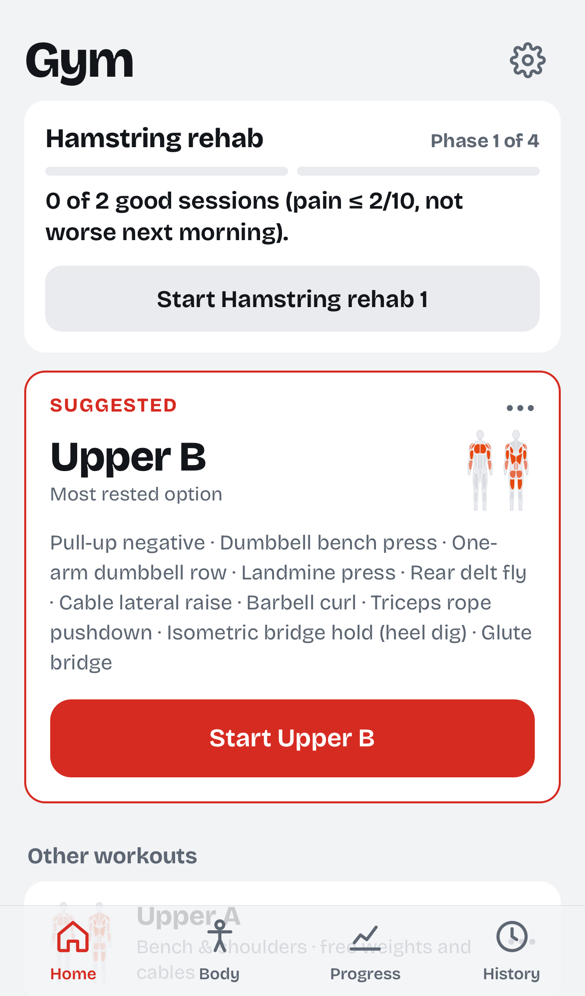
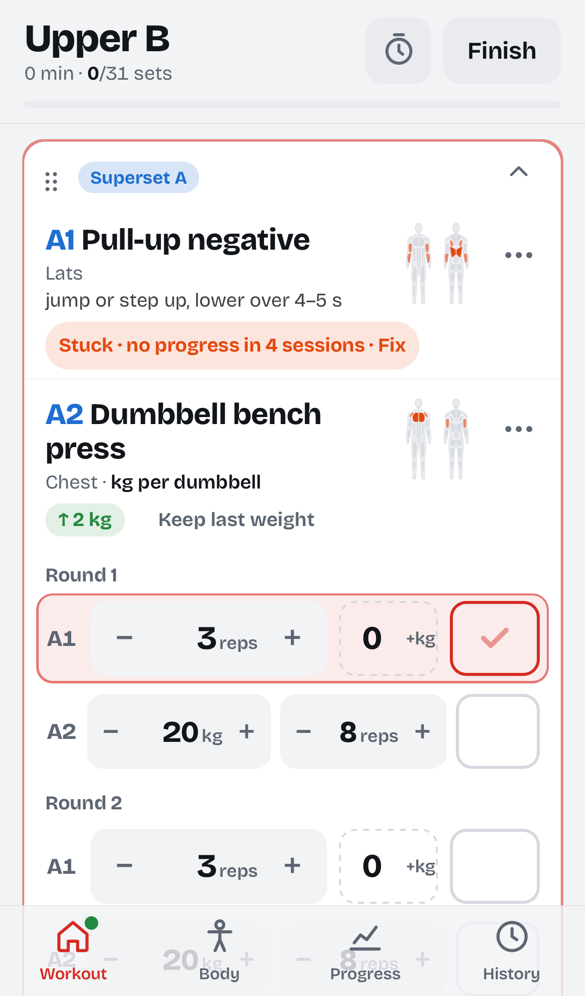
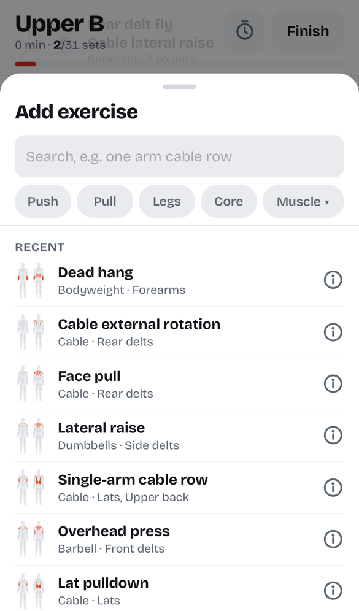
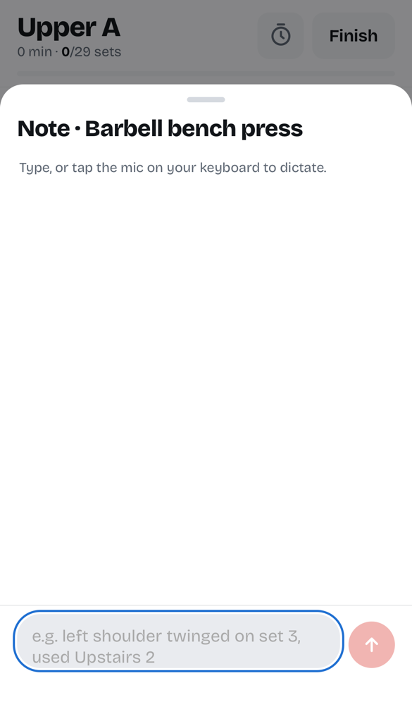
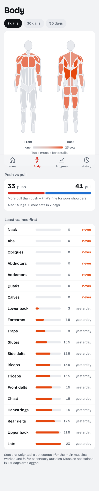
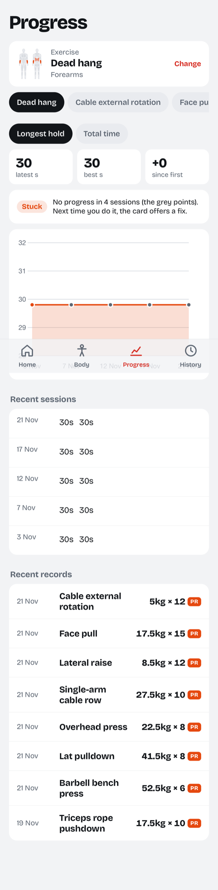
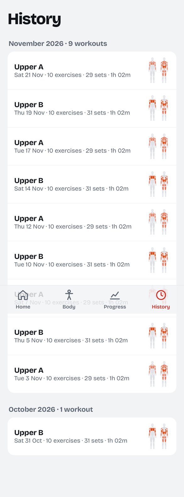
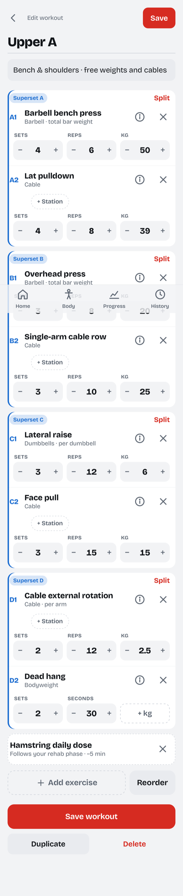
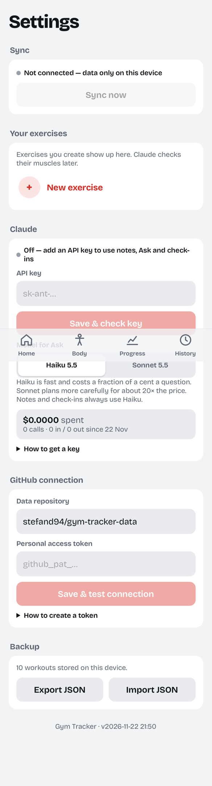

# UI/UX review: mobile Safari (iPhone)

_2026-11-22, on commit `c295373`. Review only: no code was changed._

## How this was done

- **Renderer:** Playwright WebKit 18.2 (the engine behind Safari), `iPhone 13` profile: 390 × 664 CSS px visible, DPR 3,
  touch, mobile UA. Light and dark. The dev server was run with `npm run dev`.
- **Data:** two runs. One was a fresh install, for the empty states. The other had 10 made-up Upper A/B workouts over
  the last three weeks (all sets ticked, weights rising slowly). Because the made-up data is so flat, some "Stuck" tags
  appear that real history wouldn't show.
- **Measured in the page on every screen:** the size of every visible control, the computed font size and
  `type`/`inputmode`/`autocomplete` of every field, horizontal overflow, headings and landmarks. Contrast ratios were
  computed from the colour tokens in `src/styles/base.css`.
- **Screenshots** are in [`docs/ui-review/`](ui-review/). They are 1170 px wide (3×).

**What headless WebKit can't show, so these points come from reading the code and need checking on a phone:**
the notch and home-bar insets (`env(safe-area-inset-*)` is 0 here), the on-screen keyboard, standalone-PWA chrome,
and `backdrop-filter` blur (it isn't drawn, so the frosted bars look see-through in the shots). In the full-page shots
(`*-full.png`, `10-body`, `20-progress`, …) the fixed tab bar sits mid-page. That is a capture artefact, not a bug.

---

## Top priorities

| #   | Finding                                                                                                                                                                                                                                                                                     | Where                                                   | Sev |
| --- | ------------------------------------------------------------------------------------------------------------------------------------------------------------------------------------------------------------------------------------------------------------------------------------------- | ------------------------------------------------------- | --- |
| 1   | **Content scrolls under the status bar and notch on every screen except Workout.** `black-translucent` + `viewport-fit=cover`, and only the workout header has a bar behind it, so titles and cards run under the clock and battery.                                                        | Home, Body, Progress, History, Settings, Routine editor | 🔴  |
| 2   | **Sheets with a text field at the bottom will fight the iOS keyboard.** The Note and Ask composers sit at the bottom of an `88dvh` fixed sheet. `dvh` doesn't shrink for the keyboard on iOS, so Safari pans the whole visual viewport and the sheet's top (title, grip) leaves the screen. | Note sheet, Ask sheet, Station sheet                    | 🔴  |
| 3   | **The set steppers' −/+ buttons are 32 px wide** in weight × reps rows (`.set-row.pair`). These are the most-tapped controls in the app, used with sweaty or chalked hands between sets.                                                                                                    | Workout                                                 | 🔴  |
| 4   | **Sheets aren't modal for VoiceOver.** No `aria-modal`, focus isn't moved into the sheet or given back on close, and the page behind isn't `inert`. The audit still counted every workout control as reachable while the Finish sheet was open.                                             | All sheets                                              | 🟡  |
| 5   | **Several key colour pairs fail WCAG AA**, the main one being the empty tick box outline (1.4:1). See the [contrast table](#colour-contrast).                                                                                                                                               | Workout, Progress, History                              | 🟡  |
| 6   | **Sync failures only show in Settings.** If a push to GitHub fails, Home and Workout look exactly the same as when it works.                                                                                                                                                                | Global                                                  | 🟡  |
| 7   | **The type scale has 17 sizes** (10–34 px), including 10 px and 11 px text.                                                                                                                                                                                                                 | Global                                                  | 🟢  |

---

## Global (all screens)

### Layout and viewport

| Finding                                                                                                                                                                                                                         | Sev | Recommendation                                                                                                                                                                                            |
| ------------------------------------------------------------------------------------------------------------------------------------------------------------------------------------------------------------------------------- | --- | --------------------------------------------------------------------------------------------------------------------------------------------------------------------------------------------------------- |
| **Status bar overlap.** `.app` pads by `env(safe-area-inset-top) + 12px`, which only clears the notch at scroll 0. After that, content scrolls under a transparent status bar. Only `.wo-header` (sticky, frosted) covers it.   | 🔴  | Add a fixed, frosted strip `height: env(safe-area-inset-top)` on top of every screen, the same as the nav's `--bar` (for example `body::before`), or make each page title sticky like the workout header. |
| `100dvh` is used for `.app` and the sheets. That's right for the URL bar, but on iOS `dvh` **ignores the keyboard**.                                                                                                            | 🟡  | Have a `--vvh` variable that follows `visualViewport.height` (resize/scroll listener), and size sheets that contain inputs with it.                                                                       |
| The frosted bars (`--bar` alpha 0.82 light / 0.80 dark) look see-through without blur (see `01-home.png` and the workout header in `66-finish.png`). On a phone with **Reduce Transparency** turned on, iOS drops the blur too. | 🟢  | Raise the alpha to about 0.92, so text underneath doesn't show even when the blur is off.                                                                                                                 |
| `body-map.css` uses `min(62vh, 440px)`. `vh` is the _large_ viewport on iOS. The 440 px cap keeps it safe on today's phones.                                                                                                    | 🟢  | Use `svh` for consistency.                                                                                                                                                                                |
| There's no `env(safe-area-inset-left/right)` padding. Landscape is locked in the manifest, but a Safari tab (not installed) can still rotate.                                                                                   | 🟢  | `padding-inline: max(16px, env(safe-area-inset-left))` on `.app`, `.nav-inner` and `.sheet`.                                                                                                              |
| There's no horizontal overflow on any screen (`scrollWidth` = 390 everywhere).                                                                                                                                                  | ✅  | No change needed.                                                                                                                                                                                         |

### The keyboard and fixed elements

- The **fixed tab bar** stays on screen while a number field is being edited. On iOS, fixed bottom bars float over the
  page while the keyboard is up and jump when the user scrolls. Hide the nav while a field is focused, for example
  `body:has(input:focus, textarea:focus) .nav { display: none }`. 🟡
- **Sticky sheet footers** (`.reorder` and `.exercise-editor` save bars) use `bottom: calc(-16px - env(safe-area-inset-bottom))`.
  When the keyboard is open this leaves a blank band the height of the home bar above the keyboard. Check this on a phone. 🟢

### Sheets (`src/components/Sheet.tsx`)

| Finding                                                                                                                                                                                          | Sev | Recommendation                                                                                                                                                 |
| ------------------------------------------------------------------------------------------------------------------------------------------------------------------------------------------------ | --- | -------------------------------------------------------------------------------------------------------------------------------------------------------------- |
| `role="dialog"` with no `aria-modal="true"`. Focus isn't moved into the sheet or returned to the button that opened it, and the page behind isn't `inert`.                                       | 🟡  | Set `aria-modal`. Put `inert` on `#root` while a sheet is open. Focus the title (`tabIndex=-1`) on open and restore focus to the opener on close.              |
| The grip (`.sheet-grip`) is only decoration, and swipe-down is the main way to close. Without a visible Close button, VoiceOver and Switch Control users can only close by tapping the backdrop. | 🟡  | Add a visually quiet Close button in the title row. VoiceOver's two-finger scrub would also work if it called `onClose` (`onKeyDown` Escape is already there). |
| `document.body.style.overflow = 'hidden'` works in Safari 16+. Older iOS still scrolls the page through it.                                                                                      | 🟢  | Fine for a personal app on a current iPhone.                                                                                                                   |

### Touch

- **There's no `:hover` anywhere.** Good: nothing depends on hover.
- **`:active` feedback** exists for `.btn`, `.tick`, the steppers, routine cards, `.crow` and `.prog-pick`. It's **missing** on
  `.chip`, `.menu-item`, `.menu-tile`, `.icon-btn` (⋯, settings, fold chevron), `.picker-item`, `.list-row`
  (History) and `.link-btn`. Because `-webkit-tap-highlight-color: transparent` is set globally, these give **no
  feedback at all** when tapped. 🟡 Add one shared `:active { background: var(--surface-2) }` (or an opacity dip).
- Chips are 36 px tall everywhere (Body range, Progress exercise/metric, picker filters). That's below 44, but they're
  wide and spaced, so the real risk is low. 🟢 Give them `min-height: 40px`, or keep 36 px and extend the hit area with
  `::after { inset: -4px 0 }`.

### Typography

- **17 font sizes** in the stylesheets: 10, 11, 12, 13, 14, 15, 16, 17, 18, 20, 21, 22, 24, 26, 28, 30, 34. Most of
  them are 13 and 14 (49 uses). Collapse to about 7 steps (11 · 13 · 15 · 17 · 22 · 28 · 34), the same as iOS's
  caption / footnote / subhead / body / title2 / title1 / largeTitle. 🟢
- **10 px** is used for the PR badges (`.pr-badge`, `.tick.pr::after`) and **11 px** for the tab labels, the
  `SETS/REPS/KG` labels in the routine editor and `.tag-yours`. Use 11 px at the smallest, and 12 px for anything that
  says something important (PR). 🟢
- Uppercase, letter-spaced labels show up in four places with different sizes and spacing: `SUGGESTED` (13/0.06em),
  `RECENT` in the picker, `SETS/REPS/KG` (11/0.04em) and `.menu-section` (12/0.06em). The rest of the app is sentence
  case, as `base.css` says it should be. Pick one: sentence case `.section-title` everywhere. 🟢
- **Bricolage Grotesque** gives the app real character, especially the 800-weight titles and tabular numbers on the
  steppers. Keep it.

### Colour contrast

Computed from the tokens in `base.css`. ✅ = AA pass for the size used.

| Pair                                                 | Where                                          | Light           | Dark            | Pass?                           |
| ---------------------------------------------------- | ---------------------------------------------- | --------------- | --------------- | ------------------------------- |
| `--text-dim` on `--bg` / `--surface` / `--surface-2` | Meta text, labels                              | 5.2 / 5.8 / 4.9 | 6.5 / 5.7 / 4.9 | ✅                              |
| `--accent` on `--surface`                            | "Change", "Split", "New exercise"              | 4.97            | 4.37            | Light ✅ · dark ❌ for 15–16 px |
| White on `--accent`                                  | Primary buttons (17 px bold)                   | 4.97            | **3.79**        | Light ✅ · **dark ❌**          |
| `--accent` on `--accent-soft`                        | "Add note" tile, `YOURS` tag                   | **4.09**        | **4.10**        | ❌                              |
| `--heat` on its 14% tint                             | "Stuck · … · Fix" tag (13 px)                  | **3.27**        | 4.72            | **Light ❌**                    |
| White on `--heat`                                    | PR badge (10 px)                               | **3.99**        | **2.86**        | ❌ ❌                           |
| `--rest` on its 18% tint                             | "Superset A" pill                              | **4.02**        | 4.41            | ❌ (borderline)                 |
| `--done` on `--surface`                              | Ticked set labels "A1", go-up tag              | **4.45**        | 6.16            | Light ❌ (by a hair)            |
| `--skip` on `--surface`                              | Skipped badges                                 | **2.64**        | 3.30            | ❌                              |
| `--border` on `--surface` (non-text, needs 3:1)      | **Empty tick box outline**, dashed "+kg" field | **1.42**        | **1.49**        | ❌                              |

The empty tick box is what tells you "this set is next to do". Its outline at 1.4:1 is the most important fail on the
list. Darken the tick's border to about `#9aa2ad` in light (3.0:1) and `#5b6472` in dark. For the accent pairs, darken
`--accent` in dark mode to about `#d93a31`, or put dark text on the soft tints instead of the accent colour.

---

## Home

 · [full page](ui-review/01-home-full.png) · [dark](ui-review/01-home-dark.png) ·
[fresh install](ui-review/00-home-empty.png) · [routine menu](ui-review/02-home-routine-menu.png)

**First impression:** the right thing wins. "Start Upper B" is the only filled red button and sits at about 70% of
screen height, in easy thumb reach. The rehab card above it pushes it down, but that order is deliberate.

| Finding                                                                                                                                                                   | Sev | Recommendation                                                                                                            |
| ------------------------------------------------------------------------------------------------------------------------------------------------------------------------- | --- | ------------------------------------------------------------------------------------------------------------------------- |
| The rehab card's grey "Start Hamstring rehab 1" button is the **first big button** on screen, and it's nearly as heavy as the red one below. Two "Start" buttons compete. | 🟡  | Make the rehab start a text button or a compact chip ("Start dose"). The suggested card keeps the only full-width button. |
| The suggested card lists all 10 exercises as one dot-separated paragraph (5 lines). It's the longest block of text on Home and it's hard to scan.                         | 🟢  | Show the first 4 and "+6 more", or show muscle groups ("Back, chest, shoulders, arms · 10 exercises").                    |
| The `SUGGESTED` eyebrow is the only uppercase label in a sentence-case app.                                                                                               | 🟢  | "Suggested" in sentence case, or drop it: the red outline already marks the card.                                         |
| The ⋯ on each routine card is 44 × 44, but it sits flush against the card's tap area ("start this routine"). A slightly-off tap **starts a workout**.                     | 🟡  | Separate them with an 8 px gap and a hairline divider, or ask "Start Upper A?" when a non-suggested card is tapped.       |
| Fresh install: "Last 7 days" shows an all-grey body map with a "none → most sets" legend and no message.                                                                  | 🟢  | Empty-state line: "Muscles you train this week light up here."                                                            |
| The routine menu (Edit / Duplicate / Delete) has no Start or "Start with changes…". To check a routine's sets before starting, you go Edit → back → Start.                | 🟢  | Add "View" or "Start" at the top of this menu.                                                                            |
| The Ask Claude bar only appears once an API key is set. Without one there's no hint the feature exists.                                                                   | 🟢  | This is deliberate (cost). A quiet "Set up Claude" in Settings is enough. It's already there.                             |

**Taps for core tasks:** start the suggested workout = **1**. Start another routine = **1** (scroll + tap).
Start an empty workout = **1** (after scrolling past 6 routine cards).

---

## Workout (the main screen)

 · [after two ticks](ui-review/61-workout-after-ticks.png) ·
[full page](ui-review/60-workout-full.png) · [dark](ui-review/60-workout-dark.png) ·
[end of list](ui-review/69-workout-end.png) · [⋯ menu](ui-review/63-workout-item-menu.png) ·
[Finish sheet](ui-review/66-finish.png) · [number field focused](ui-review/62-workout-number-focus.png)

**First impression:** strong. The current set is outlined in red, the numbers are big and tabular, ticked sets go
solid green with a PR flag, and the progress bar in the header fills as you go. It reads like a tool made for the gym
floor.

### Touch and thumb reach

| Finding                                                                                                                                                                                                                                                                                             | Sev | Recommendation                                                                                                                                                                                            |
| --------------------------------------------------------------------------------------------------------------------------------------------------------------------------------------------------------------------------------------------------------------------------------------------------- | --- | --------------------------------------------------------------------------------------------------------------------------------------------------------------------------------------------------------- |
| **The −/+ on weight × reps rows are 32 × 50** (the reps-only/bodyweight rows are 46 wide). The kg and reps steppers sit side by side, so a slightly-off "+" on kg can land on "−" on reps.                                                                                                          | 🔴  | Keep 44 px buttons and win the width back elsewhere. Drop the `A1/A2` gutter label on the row (the round header and the item header already say it), or stack kg above reps on narrow screens (< 400 px). |
| The number field inside a stepper is 20–43 px wide. Its `<label>` wrapper makes the whole middle tappable, which is good. But a focused stepper has **no focus style** (`outline: none`, and `.stepper` has no `:focus-within`, unlike `.numin`). In `62-workout-number-focus.png` nothing changes. | 🟡  | Add `.stepper:focus-within { box-shadow: 0 0 0 2px var(--rest) }`, the same as `.numin`.                                                                                                                  |
| The rest **timer** and **Finish** are top-right, the hardest corner to reach one-handed. Finish is fine there (rare, and there's a big Finish at the end of the list). The timer is used after **every set**.                                                                                       | 🟡  | Start rest automatically on tick (already an option, so leave it as Stefan chose), or put a timer button on the current set's row or in the RestBar near the bottom.                                      |
| The drag grip (⋮⋮) is 36 × 54. It works, but it's below 44 wide and sits right at the card edge.                                                                                                                                                                                                    | 🟢  | Pad the hit area to 44 with `::before { inset: 0 -4px }`.                                                                                                                                                 |
| "Keep last weight" (116 × 32), the go-up/stuck tags (32 tall) and "Muscles worked so far / Hide" (32 tall) are all under 44.                                                                                                                                                                        | 🟢  | `min-height: 44px` on `.link-btn`, `.goup-tag` and `.map-toggle`. Their text size doesn't need to change.                                                                                                 |
| The ⋯ menu is clean: three tiles, then actions, then Remove set apart in red, guarded by "Tap again to remove". Skip and Remove last set act straight away.                                                                                                                                         | 🟢  | An undo toast for Skip and Remove last set would cover slips mid-set.                                                                                                                                     |

### Forms

- Every number field uses `inputmode="numeric"` or `"decimal"`, and font sizes are **20–22 px**, so **Safari won't
  auto-zoom** here. A comma decimal (`"62,5"`) is handled in `Stepper.commit`. ✅
- The workout name is an `<input>` styled as the title (26 px) with `outline: none`. It looks like static text,
  so tapping it to rename is hidden, and when it's focused nothing shows it. 🟢 Add a faint underline on `:focus`, the
  same as `.re-name:focus` in the routine editor.
- The workout screen has **no `<h1>`**: the title is an input with `aria-label="Workout name"`. VoiceOver's rotor
  finds no headings to jump between exercises. 🟡 Add a visually hidden `<h1>` and make exercise names `<h3>`.
- `ItemHead.tsx:75` sets `aria-expanded` with no value, which React renders as `"true"` even when the card is folded. 🟢
  Pass the real state.

### Flow

- **Log a set as planned: 1 tap** (the tick). Change the weight by 2.5 kg and log: 2 taps. Very good.
- **Add a note mid-set: 3 taps** (⋯ → Add note → type → send). Fine.
- **Finish: 2 taps** (Finish → Finish and save). The sheet clearly says "29 sets not ticked will be left out". ✅
- **There's no loading or error feedback when a finished workout syncs.** It's queued silently (see the Global sync point).
- The 0/31-sets counter and red progress bar are clear. The header's "Finish" stays grey until 80% of sets are done,
  so it doesn't nag. ✅

---

## Exercise picker (Add exercise / Replace)

 · [search "row"](ui-review/65-exercise-picker-search.png)

| Finding                                                                                                                                                                                                      | Sev | Recommendation                               |
| ------------------------------------------------------------------------------------------------------------------------------------------------------------------------------------------------------------ | --- | -------------------------------------------- |
| The search field is `type="search"` with `enterkeyhint="search"` and 16 px text, so **no zoom**. ✅ But it has **no label**: only a placeholder, which VoiceOver may read and then lose once the user types. | 🟡  | `aria-label="Search exercises"`.             |
| No `autocorrect="off"` / `autocapitalize="off"` / `spellcheck={false}`. iOS will "correct" `rdl` → "rd", `db row` → "do row" and so on, fighting the alias search.                                           | 🟡  | Add all three (Settings' fields already do). |
| The rows are 56 px, the ⓘ is separate from the row, and there's a 40 × 40 clear button. Good sizes.                                                                                                          | ✅  | No change needed.                            |
| `RECENT` is an uppercase section label (see Typography).                                                                                                                                                     | 🟢  | Sentence case.                               |

---

## Note and Ask sheets

| Finding                                                                                                                                                                                                                                               | Sev | Recommendation                                                                                                                                                         |
| ----------------------------------------------------------------------------------------------------------------------------------------------------------------------------------------------------------------------------------------------------- | --- | ---------------------------------------------------------------------------------------------------------------------------------------------------------------------- |
| **The keyboard problem (top priority #2).** A tall `88dvh` sheet with the composer pinned to the bottom. When the keyboard opens, iOS pans the visual viewport, the title scrolls out of view, and the fixed sheet can jump when the keyboard closes. | 🔴  | Size the sheet to `visualViewport.height` while the composer has focus (or don't use `sheet-tall` for an empty thread). Move the composer up when the thread is empty. |
| An empty thread leaves about 60% of the sheet as blank white between the hint and the composer.                                                                                                                                                       | 🟢  | Shrink the sheet to fit when there are no messages.                                                                                                                    |
| The composer's textarea is 16 px, so **no zoom**. ✅ The send button is pink at 40% opacity when disabled, which reads as an error and not as "not yet".                                                                                              | 🟢  | Use a grey disabled state for primary buttons app-wide (also in Settings).                                                                                             |
| The textarea has no `aria-label`; its placeholder doubles as the instruction.                                                                                                                                                                         | 🟢  | `aria-label="Note for Barbell bench press"`.                                                                                                                           |

---

## Body

 · [dark](ui-review/10-body-dark.png) · [fresh install](ui-review/00-body-empty.png)

| Finding                                                                                                                                                                                                    | Sev | Recommendation                                                                                          |
| ---------------------------------------------------------------------------------------------------------------------------------------------------------------------------------------------------------- | --- | ------------------------------------------------------------------------------------------------------- |
| The body map plus "Least trained first" is a good layout. The heat colours read well in both themes.                                                                                                       | ✅  | No change needed.                                                                                       |
| "Tap a muscle for details": the muscle regions are `<path onClick>` inside an `<svg role="img">` (`BodyMap.tsx:92,100`). `role="img"` hides its children, so **VoiceOver can't reach the muscle details**. | 🟡  | Make the "Least trained first" rows the accessible route: each row a button that opens the same detail. |
| The 7/30/90 day chips are 36 px tall (see Touch).                                                                                                                                                          | 🟢  | Use a 44 px segmented control like the one in Settings.                                                 |
| "never" is in orange-red on 7 rows. In a 7-day view, "never" mixes two timelines (all-time vs. this week).                                                                                                 | 🟢  | "not yet" or "> 10 days", matching the footnote.                                                        |
| The bars have no scale. "23" and "0.5" share one bar, so a sliver can be read as zero.                                                                                                                     | 🟢  | Fine: the number sits next to it.                                                                       |

---

## Progress

 · [exercise chooser](ui-review/21-progress-exercise.png) ·
[fresh install](ui-review/00-progress-empty.png)

| Finding                                                                                                                                                                              | Sev | Recommendation                                                     |
| ------------------------------------------------------------------------------------------------------------------------------------------------------------------------------------ | --- | ------------------------------------------------------------------ |
| The row of recent-exercise chips scrolls sideways and cuts the last chip off mid-word ("Face pu"). That works as a scroll hint, but there's no fade, so it looks clipped by mistake. | 🟢  | Add a 24 px fade on the right edge with `mask-image`.              |
| The chart's axis text (Chart.js) is about 11 px grey. The flat line at 30 s gives a y-axis from 29 to 32 that makes a hold look precise.                                             | 🟢  | Set the axis to `beginAtZero` for holds, or pad the range to ±10%. |
| "Recent records" PR badges: 10 px white on orange, **2.9:1 in dark** (see contrast).                                                                                                 | 🟡  | 11–12 px, darker orange.                                           |
| Fresh install: "Choose an exercise" with "Change" in red. "Change" doesn't make sense when nothing is chosen yet, and the card isn't obviously the way forward.                      | 🟢  | "Choose" when nothing is selected. Make the whole card the button. |
| There's no way from a Workout card to that exercise's Progress (History detail has links).                                                                                           | 🟢  | Add "Progress" to the ⋯ menu, next to How to.                      |

---

## History

 · [Workout detail](ui-review/31-history-detail.png) ·
[fresh install](ui-review/00-history-empty.png)

| Finding                                                                                                                                                         | Sev | Recommendation                                                                                                        |
| --------------------------------------------------------------------------------------------------------------------------------------------------------------- | --- | --------------------------------------------------------------------------------------------------------------------- |
| The list is clean: grouped by month with a count, and each row shows its muscle map. ✅                                                                         | ✅  | No change needed.                                                                                                     |
| `.list-row` has no `:active` state. A tap gives no feedback until the route changes.                                                                            | 🟡  | Covered by the Touch point.                                                                                           |
| Detail: superset labels are **SS1 / SS2** here but **A1 / A2** on the Workout and Routine screens.                                                              | 🟡  | Use A1/A2 everywhere.                                                                                                 |
| Detail: each exercise's "Progress" link is **57 × 16**, red, underlined and right-aligned. That's the smallest target in the app, and the only underlined link. | 🟡  | Make the whole exercise row the link to Progress (with a chevron), or give the link `padding: 14px 0` to reach 44 px. |
| Detail: the back link ("‹ History") is small grey text above a large title. That's correct iOS style, but the tap area is the text only.                        | 🟢  | Give it 44 px of height.                                                                                              |
| Detail: "Delete workout" opens a confirm sheet that says it's also removed from GitHub. ✅                                                                      | ✅  | No change needed.                                                                                                     |
| Fresh install: "No workouts yet. Finish one and it'll show up here." is clear, but leaves you stuck there.                                                      | 🟢  | Add a "Start a workout" button.                                                                                       |

---

## Routine editor

 · [new routine](ui-review/51-routine-new.png)

| Finding                                                                                                                                                                | Sev | Recommendation                                                                                            |
| ---------------------------------------------------------------------------------------------------------------------------------------------------------------------- | --- | --------------------------------------------------------------------------------------------------------- |
| The **−/+ are 30 × 42** in the SETS / REPS / KG steppers. That's smaller than on the Workout screen, and this screen has three per row.                                | 🟡  | Use the same 44 px steppers as the workout, two rows per exercise if needed.                              |
| There are **two Save buttons** (top-right "Save" and a full-width "Save workout" at the bottom), and "Workout" in the button means "routine".                          | 🟢  | Keep the sticky top Save only, and call it "Save routine". The bottom becomes Duplicate / Delete.         |
| **"Split"** is red text, top-right of each superset. In this app, red means "primary" or "destructive", and Split is neither.                                          | 🟢  | Grey `.link-btn`, or move it into the Reorder sheet's Superset menu where the other superset actions are. |
| The A1/B1 labels sit on the card's left border and touch the blue superset rail (see A1/A2).                                                                           | 🟢  | 4 px more left padding.                                                                                   |
| The `SETS / REPS / KG` labels are 11 px uppercase.                                                                                                                     | 🟢  | 12–13 px sentence case ("Sets").                                                                          |
| "+ Station" chip is 81 × 32.                                                                                                                                           | 🟢  | 44 px tall hit area.                                                                                      |
| The name field is 28 px with a hairline underline, and its placeholder "Workout name" goes away once you type. ✅ The description field is 16 px. ✅ No zoom anywhere. | ✅  | No change needed.                                                                                         |
| Known (HANDOVER): opening `/routines/<id>` straight from a not-found route shows an empty editor.                                                                      | 🟢  | No change needed.                                                                                         |

---

## Settings

| Finding                                                                                                                                                                                                | Sev | Recommendation                                                                                                                                 |
| ------------------------------------------------------------------------------------------------------------------------------------------------------------------------------------------------------ | --- | ---------------------------------------------------------------------------------------------------------------------------------------------- |
| The **API key and GitHub token fields are `type="password"`** with no `autocomplete`. iOS will offer to **save them to Passwords** under this site, and may AutoFill the wrong one into the other.     | 🟡  | `autocomplete="off"` plus `data-1p-ignore`/`data-lpignore`. Or `type="text"` with `-webkit-text-security: disc` so Keychain leaves them alone. |
| The repo field has no `inputmode` and correctly turns off autocorrect. ✅ All fields are 16 px, so **no zoom**. ✅                                                                                     | ✅  | No change needed.                                                                                                                              |
| Disabled primary buttons ("Save & check key", "Save & test connection", "Sync now") are the red button at 40% opacity, which turns them **pink**. They look like warnings, not "fill the field first". | 🟡  | Make disabled primary buttons `--surface-2` with `--text-dim` text.                                                                            |
| The Haiku/Sonnet segmented control is 40 px tall.                                                                                                                                                      | 🟢  | 44 px.                                                                                                                                         |
| **Import JSON** reports failure with `alert()`. The code itself notes `confirm()` is blocked in some installed web apps (`Sheet.tsx:126`), and `alert()` can be too.                                   | 🟡  | Show the error inline, like the sync error text.                                                                                               |
| "How to get a key" uses `
` with the default ▶ marker, the only native disclosure in the app.                                                                                                  | 🟢  | Use the app's chevron.                                                                                                                         |

---

## Global sync status (cross-screen flow)

The **only** place that shows sync state ("Not connected", pending, error) is Settings. On Home, a failing token or a
queue of unsynced workouts is invisible. Since GitHub is the only backup, this is the one silent failure that can lose
data. 🟡 Show a small status line on Home only when something is wrong ("3 workouts not synced · Fix"), and turn the
Settings tab icon amber.

---

## What works well

- **The Workout screen** is the best screen. The current set is obvious, ticks are big (≈ 60 × 50) and on the
  right-thumb side, tabular numerals don't jump, PRs show up the moment they happen, and Finish explains what it
  will leave out.
- **The visual identity** ("Iron": plate colours, Bricolage Grotesque, iOS large titles) is consistent and doesn't
  look like a template. Red = do, green = done, blue = rest is learned quickly.
- **Mobile basics are mostly right:** no input under 16 px, `inputmode` on every number field, `100dvh` not `100vh`,
  the tab bar and sheets pad for the home bar, `touch-action: manipulation` on buttons, reduced motion respected,
  no horizontal overflow, dark mode throughout.
- **Swipe-down sheets** with Escape and backdrop close feel native.

## Suggested order of work

1. Status-bar scrim on all screens (small CSS change, visible on every screen).
2. 44 px stepper buttons on weight × reps rows, and the routine editor.
3. Keyboard-safe sheets (`visualViewport` height) for Note, Ask and Station; hide the tab bar while a field has focus.
4. Contrast: tick outline, PR badge, stuck tag, dark-mode primary button; grey disabled buttons.
5. Shared `:active` feedback; sheet focus handling, `aria-modal` and `inert`.
6. Sync status on Home.
7. Type-scale tidy (fewer sizes, no 10 px, sentence-case labels).
